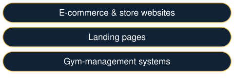

I build store websites, landing pages, and complete gym-management systems.

## Live work

<table>
<tr>
<td></td>
<td></td>
</tr>
<tr>
<td></td>
<td></td>
</tr>
</table>

## Portfolio

My portfolio is an animated walk on the Alexandria corniche. You scroll, and my work appears shop by shop:
**[yahia-reda.is-a.dev](https://yahia-reda.is-a.dev/)**

